## Sign in {#sign-in}

The links' address followed by `/admin/links` opens the sign-in page. Enter the administrator password: the one set in
Settings, else the one from `secrets/password`. A session lasts 12 hours.

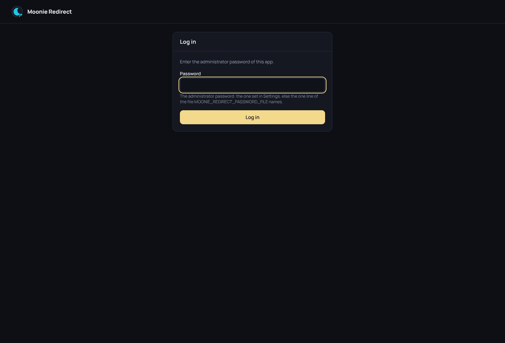

## The links {#links}

**Links**, in the menu on the left, lists the fixed links, most recently modified first, with their path, name,
target, last day and change date. Choosing a row opens its form on the right; **Copy** copies its address.

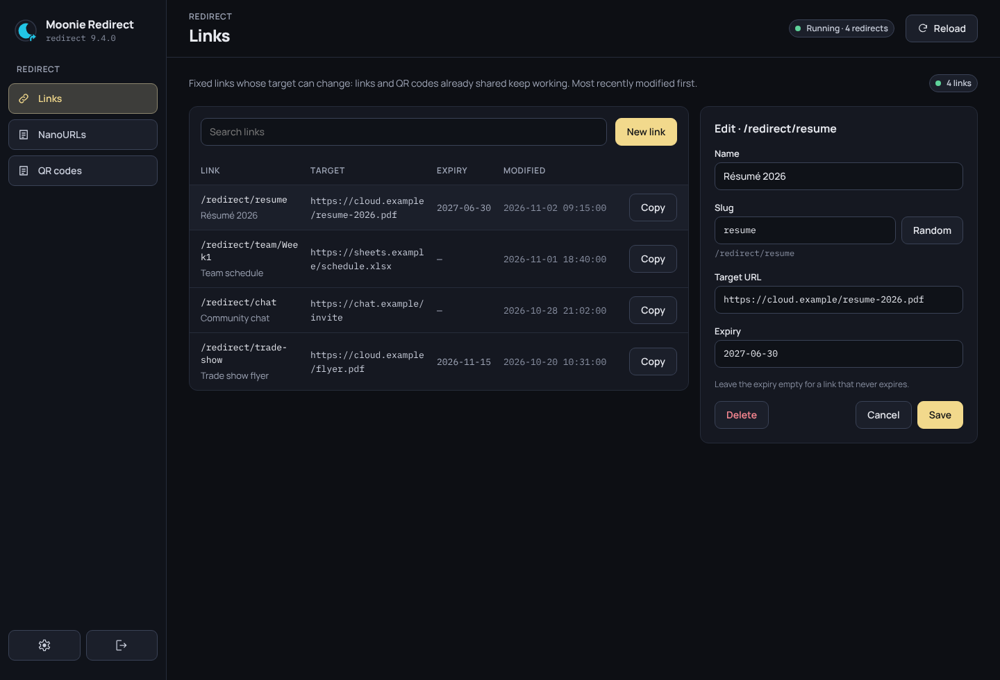

## A new link {#new-link}

**New link** opens an empty form. A free path is already suggested in **Slug**, and **Random** draws another one. Give
a name and the target, and a last day in **Expiry** if the link must stop. **Save** creates it. See
[A link](links-nanourls-qrcodes.md#a-link).

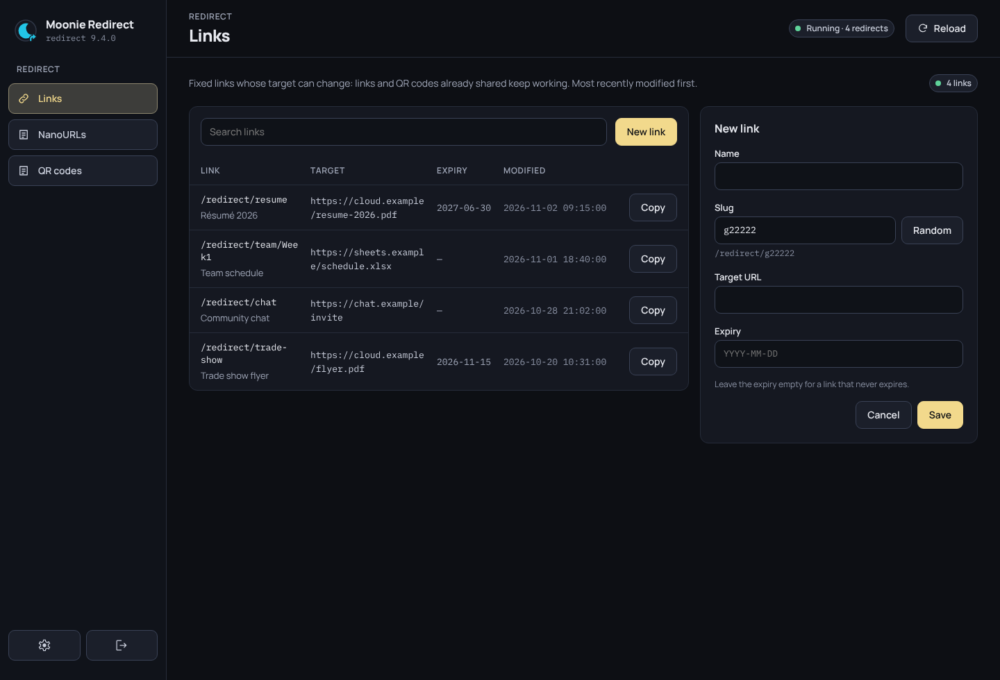

## A link's address {#link-address}

Once a Cloudflare host is set up, the form has a **Link address** choice: the local network or a host. The list shows
where each link answers and its state, here pending, error and active. See
[A link's address](cloudflare.md#link-address).

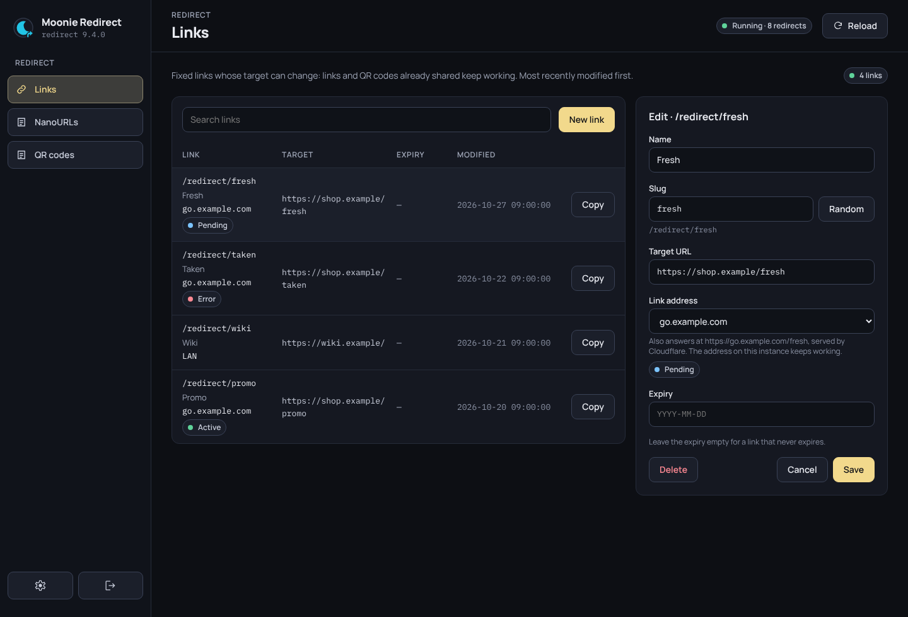

## The NanoURLs {#nanourls}

**NanoURLs** lists the short links: a name and a target each, with the short link `/links/<id>` to share. The form
needs only the name and the target URL.

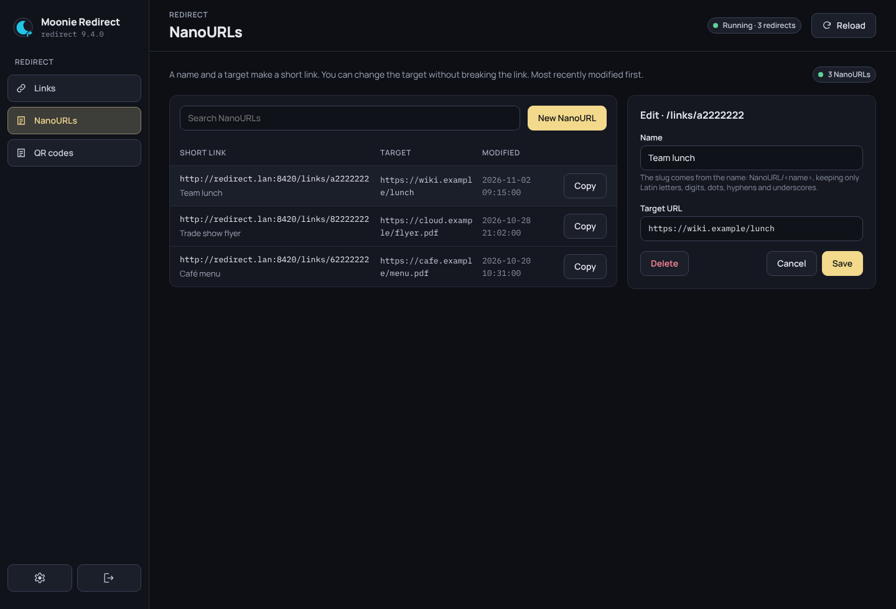

## A QR code and its design {#qr-code}

**QR codes** lists the codes with a thumbnail, **Copy** and **Download SVG**. The form adds a **Design** part: the
colors of the modules, the corners and the background, their shapes and the margin. The preview above the settings is
drawn again at every change.

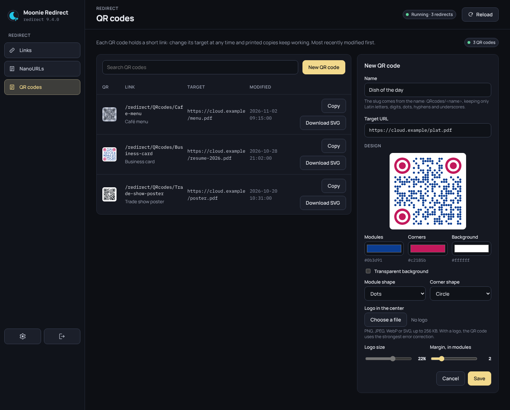

## A logo in the center {#qr-logo}

**Choose a file** puts a logo in the center (PNG, JPEG, WebP or SVG, 256 KiB at most); **Logo size** sets how much
room it takes, and the preview shows it at once. See [A QR code](links-nanourls-qrcodes.md#a-qr-code).

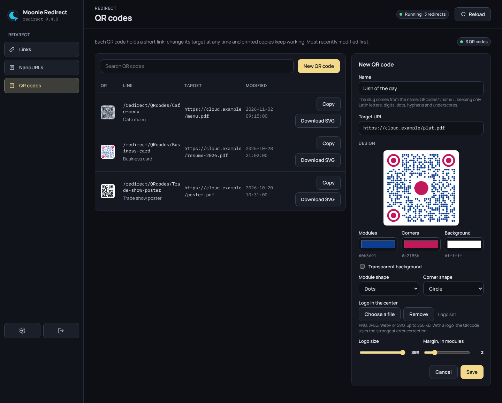

## Settings: Security {#settings-security}

The gear at the bottom left opens **Settings**. The **Security** tab says where the password comes from, how long
sessions last and how many are open, and offers **Change password** and **End all sessions**.

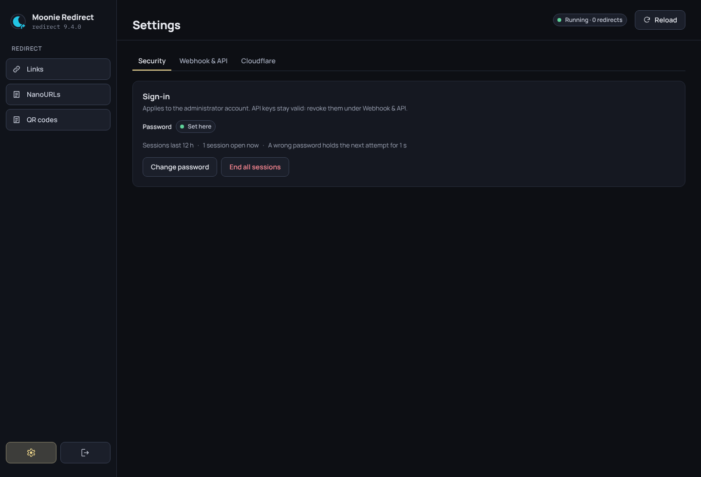

## Settings: the webhook {#settings-webhook}

The **Webhook & API** tab holds the receiver's URL, the signing secret and the events to send. **Send test** sends one
test event; **Delivery** shows the last delivery and what waits. See [The webhook](settings.md#webhook).

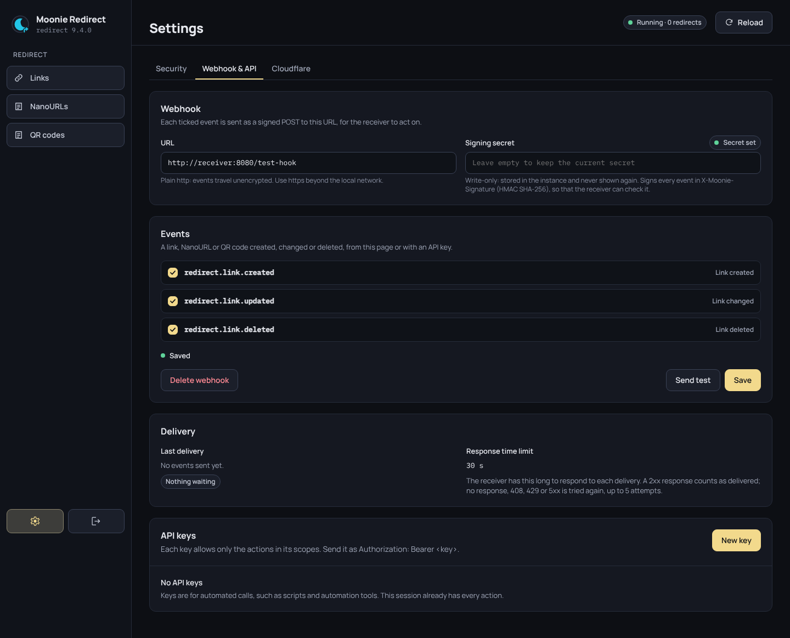

## Settings: API keys {#settings-api-keys}

Under the webhook, **API keys** lists the keys with their prefix, scopes and last use. **Revoke** ends one at once.

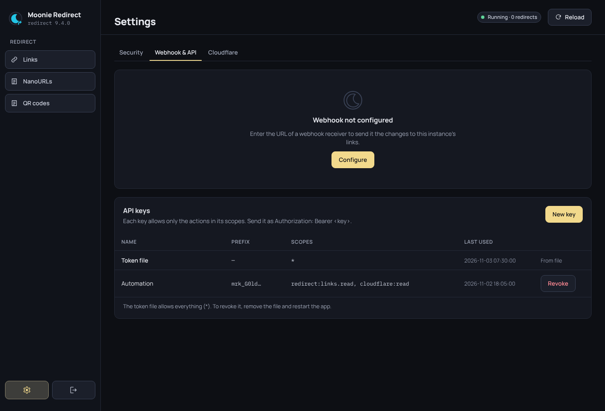

**New key** asks for a name, the scopes (the known ones are offered below the field) and your password. The key shows
once, after **Create key**. See [API keys](settings.md#api-keys).

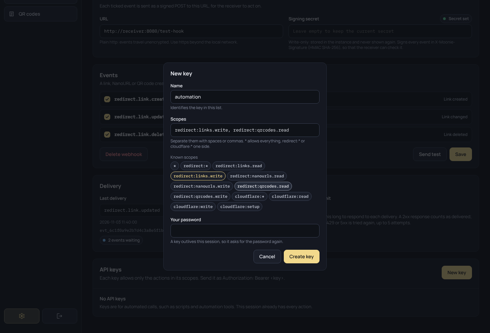

## Cloudflare hosts {#cloudflare-hosts}

The **Cloudflare** tab holds the API token and its state, the list item limit, **Sync now**, **Compare with
Cloudflare**, and the hosts already set up, with their zone, account, DNS record and page for unknown paths.

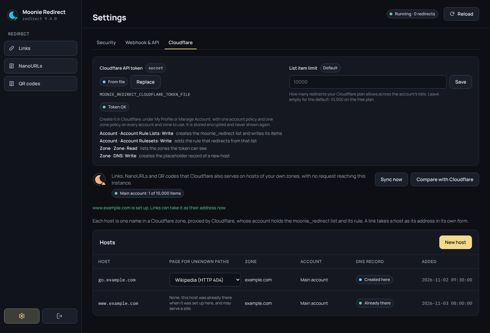

**New host** asks for a zone and a name, then shows the plan: what will be done in Cloudflare, step by step. Nothing
changes before **Confirm the plan**; a name that already serves something asks for a tick first. See
[Add a host](cloudflare.md#add-a-host).

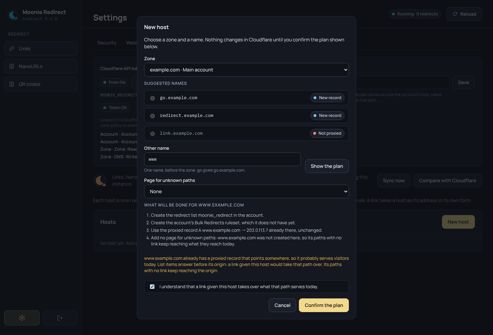
