## Se connecter {#sign-in}

L'adresse des liens suivie de `/admin/links` ouvre la page de connexion. Saisissez le mot de passe d'administration :
celui réglé dans Settings, sinon celui de `secrets/password`. Une session dure 12 heures.

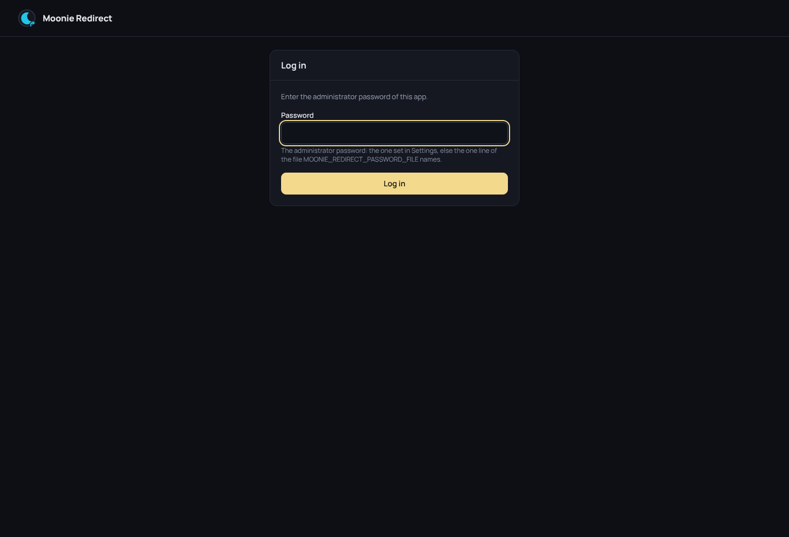

## Les liens {#links}

**Links**, dans le menu de gauche, liste les liens fixes, les plus récemment modifiés en premier, avec leur chemin,
leur nom, leur cible, leur dernier jour et leur date de modification. Choisir une ligne ouvre son formulaire à droite ;
**Copy** copie son adresse.

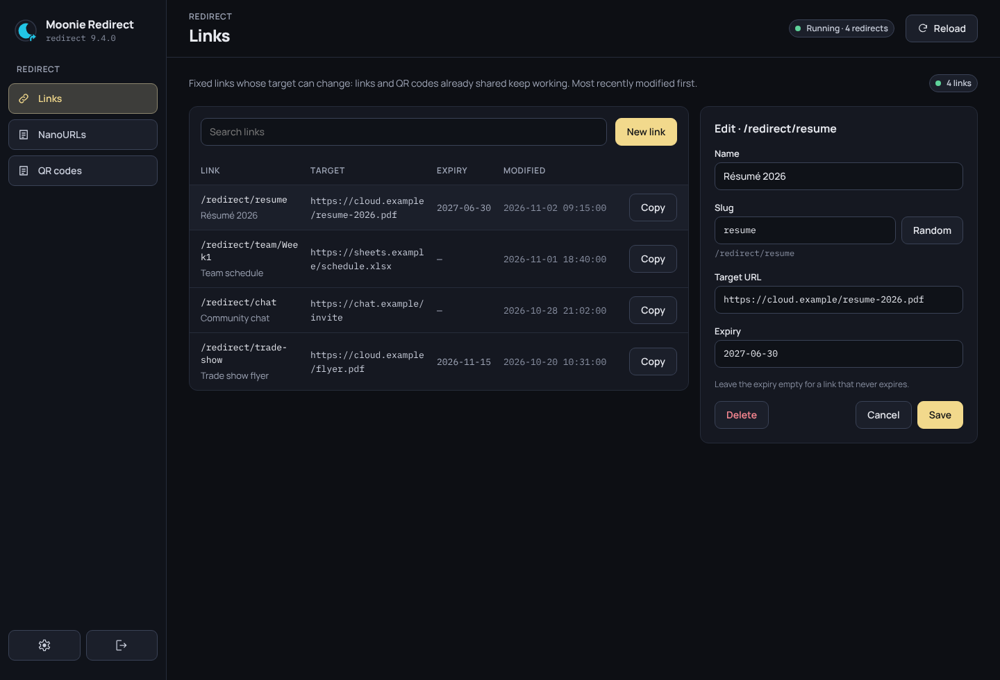

## Un nouveau lien {#new-link}

**New link** ouvre un formulaire vide. Un chemin libre est déjà proposé dans **Slug**, et **Random** en tire un autre.
Donnez un nom et la cible, et un dernier jour dans **Expiry** si le lien doit s'arrêter. **Save** le crée. Voir
[Un lien](links-nanourls-qrcodes.md#a-link).

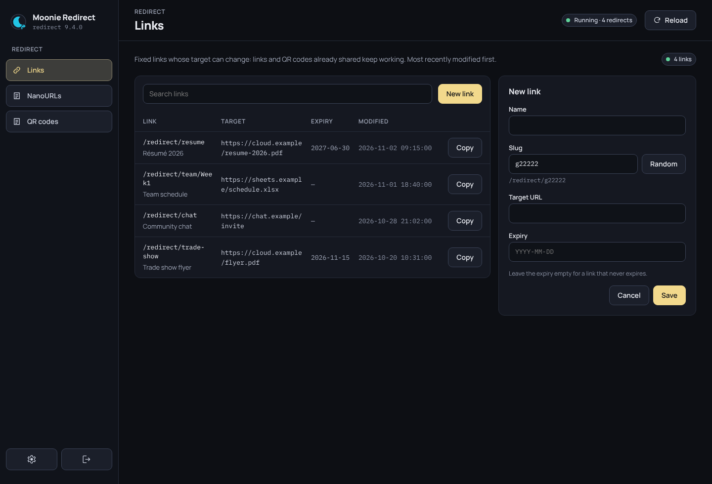

## L'adresse d'un lien {#link-address}

Une fois un nom Cloudflare en place, le formulaire propose le choix **Link address** : le réseau local ou un nom. La
liste montre où répond chaque lien et son état, ici en attente, en erreur et actif. Voir
[L'adresse d'un lien](cloudflare.md#link-address).

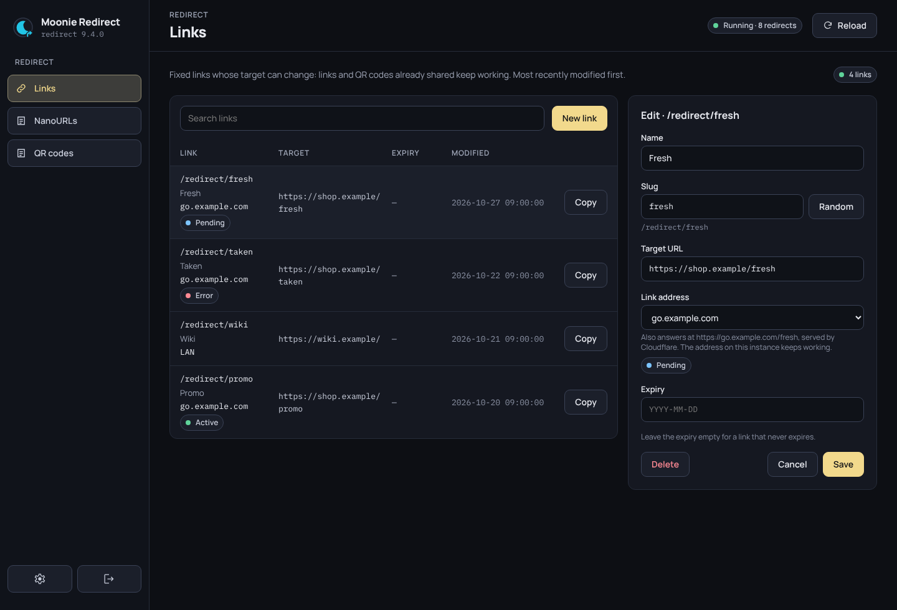

## Les NanoURL {#nanourls}

**NanoURLs** liste les liens courts : un nom et une cible chacun, avec le lien court `/links/<id>` à partager. Le
formulaire ne demande que le nom et la cible.

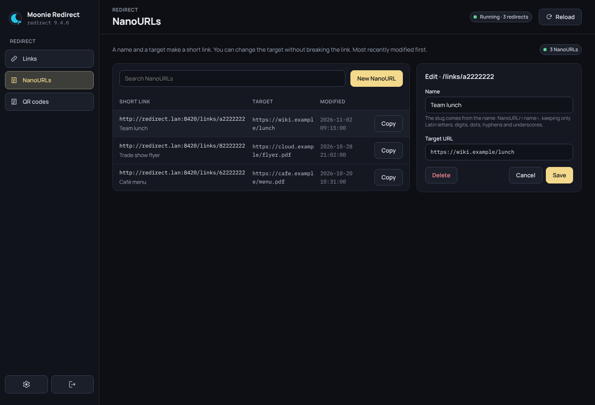

## Un QR code et son dessin {#qr-code}

**QR codes** liste les codes avec une vignette, **Copy** et **Download SVG**. Le formulaire ajoute une partie
**Design** : les couleurs des modules, des coins et du fond, leurs formes et la marge. L'aperçu au-dessus des réglages
est redessiné à chaque changement.

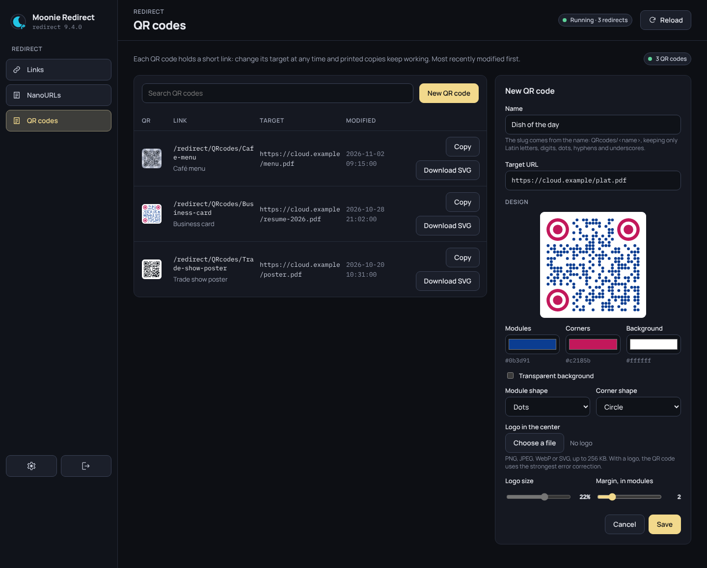

## Un logo au centre {#qr-logo}

**Choose a file** met un logo au centre (PNG, JPEG, WebP ou SVG, 256 Kio au plus) ; **Logo size** règle la place
qu'il prend, et l'aperçu le montre aussitôt. Voir [Un QR code](links-nanourls-qrcodes.md#a-qr-code).

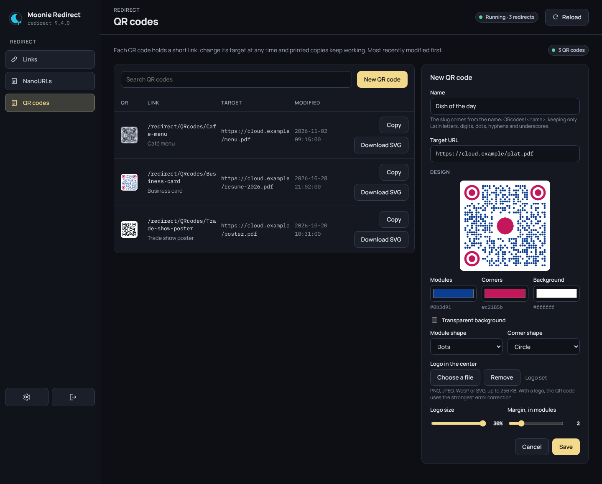

## Réglages : la sécurité {#settings-security}

La roue dentée en bas à gauche ouvre **Settings**. L'onglet **Security** dit d'où vient le mot de passe, combien de
temps durent les sessions et combien sont ouvertes, et propose **Change password** et **End all sessions**.

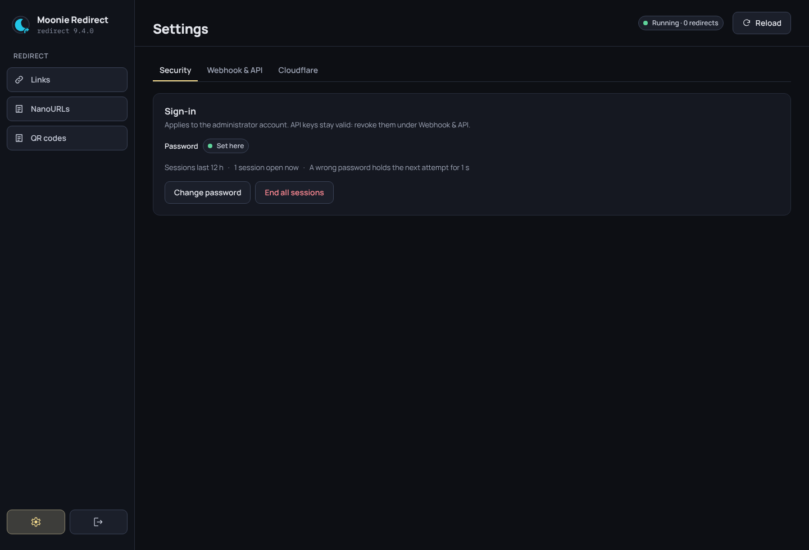

## Réglages : le webhook {#settings-webhook}

L'onglet **Webhook & API** porte l'adresse du récepteur, le secret de signature et les événements à envoyer. **Send
test** envoie un événement de test ; **Delivery** montre la dernière livraison et ce qui attend. Voir
[Le webhook](settings.md#webhook).

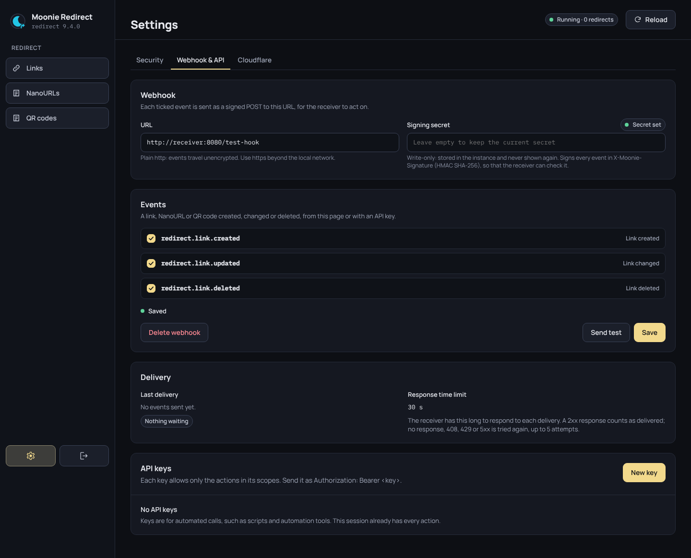

## Réglages : les clés d'API {#settings-api-keys}

Sous le webhook, **API keys** liste les clés avec leur préfixe, leurs droits et leur dernier usage. **Revoke** en
retire une aussitôt.

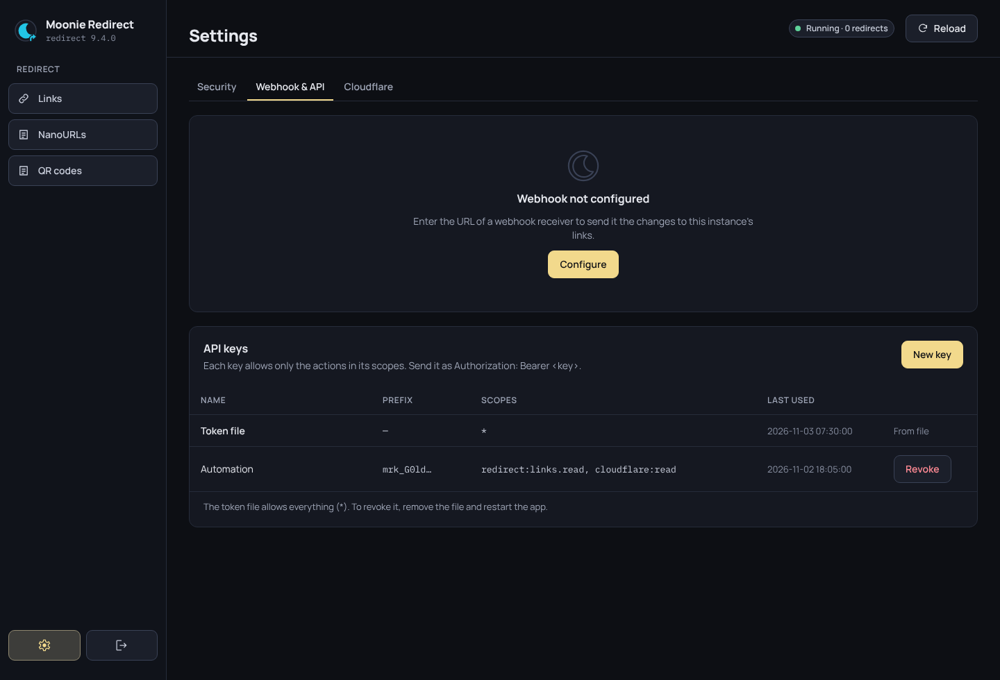

**New key** demande un nom, les droits (ceux connus sont proposés sous le champ) et votre mot de passe. La clé
s'affiche une seule fois, après **Create key**. Voir [Les clés d'API](settings.md#api-keys).

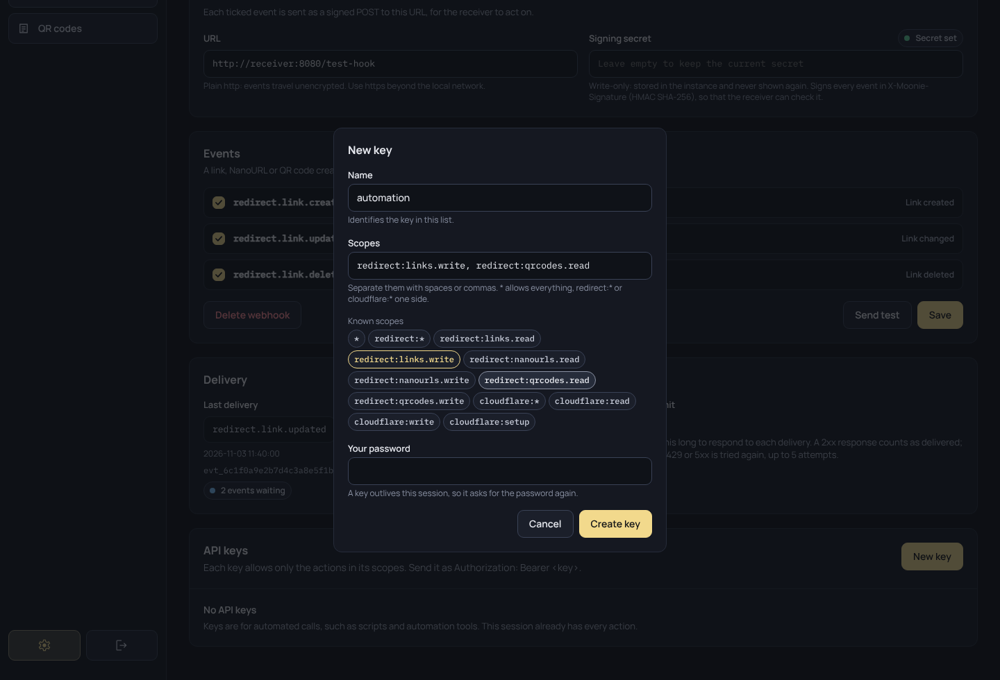

## Les noms Cloudflare {#cloudflare-hosts}

L'onglet **Cloudflare** porte le jeton d'API et son état, la limite d'éléments de liste, **Sync now**, **Compare with
Cloudflare**, et les noms déjà en place, avec leur zone, leur compte, leur enregistrement DNS et leur page pour les
chemins inconnus.

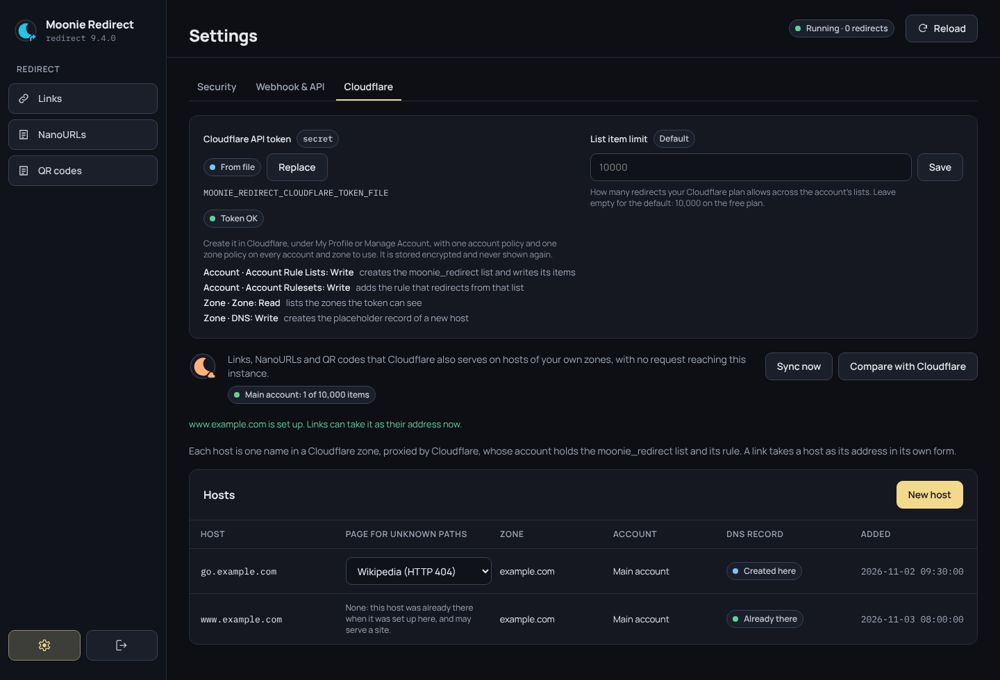

**New host** demande une zone et un nom, puis montre le plan : ce qui sera fait dans Cloudflare, étape par étape. Rien
ne change avant **Confirm the plan** ; un nom qui sert déjà quelque chose demande d'abord de cocher une case. Voir
[Ajouter un nom](cloudflare.md#add-a-host).

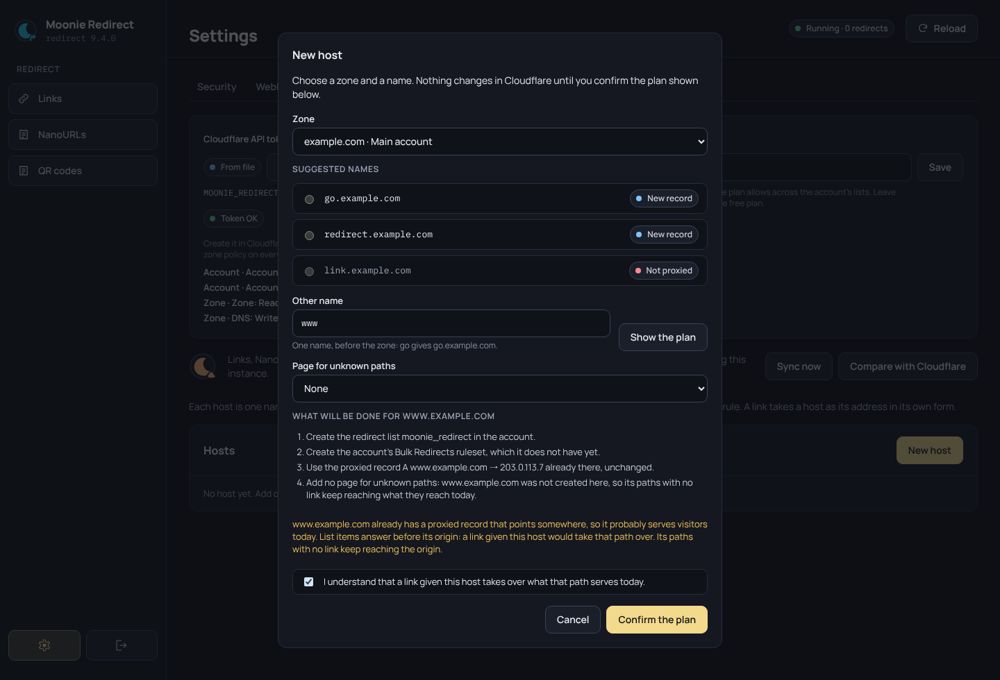
